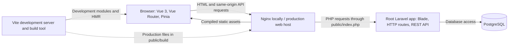

# Mealplaner architecture

## Audit scope and conclusion

Audited on **2026-11-02** from source, both root manifests/lockfiles, installed packages
in the already-running Compose services, and non-destructive verification commands.
Mealplaner is an existing **single Laravel application with an integrated Vue SPA**.
It matches the required architecture; no architectural replacement or restructuring
is needed. There are no `backend/` or `frontend/` application directories. TASK-02
subsequently stabilized database-independent health, preserved database readiness, and
resolved the audit's test/formatting failures without changing this architecture.
TASK-03 reuses the same Vue/Vite foundation, adds Mealplaner content and accessible
route titles/focus, and verifies the existing development browser/HMR workflow.

The current interface is a reusable starter. Mealplaner's **MVP v0.1.0** domain features
are planned: registration/login/logout; user-owned nutritional products; recipes and
quantity-based nutrition calculation; dated consumption records; and daily calorie,
protein, carbohydrate, and fat totals. None of those features is implemented yet.

## Detected technology and versions

The versions below are locked and installed in the running containers unless described
as runtime/image versions. They are observations, not newly selected dependencies.

| Area                             | Requirement or configuration                             | Detected version                                                                     |
| -------------------------------- | -------------------------------------------------------- | ------------------------------------------------------------------------------------ |
| PHP                              | Root Composer requirement `^8.5`; `php:8.5-fpm-bookworm` | 8.5.12 in `backend`; host PHP is 8.4.1 and incompatible with the project requirement |
| Composer                         | Existing image uses Composer 2                           | 2.10.3 in `backend`; 2.8.3 on host                                                   |
| Laravel                          | `laravel/framework: ^13.0`                               | 13.39.0                                                                              |
| Vue                              | `vue: ^3.5.17`                                           | 3.5.44                                                                               |
| Vue Router / Pinia               | `^4.5.1` / `^3.0.3`                                      | 4.6.4 / 3.0.4                                                                        |
| TypeScript / Vue TSC             | `~5.8.3` / `^3.0.3`                                      | 5.8.3 / 3.3.14                                                                       |
| Vite                             | `^7.2.2`                                                 | 7.3.7                                                                                |
| Laravel Vite plugin / Vue plugin | `^2.0.0` / `^6.0.0`                                      | 2.1.0 / 6.0.10                                                                       |
| PWA build support                | `vite-plugin-pwa: ^2.0.0`, Workbox generation            | 2.0.0                                                                                |
| Node.js / npm                    | Node engine `^22.12.0                                    |                                                                                      | >=24.0.0`; `node:24-bookworm-slim` | 24.22.2 / 11.19.1 in `frontend`; 24.19.0 / 11.17.0 on host |
| PostgreSQL                       | `postgres:18-alpine`                                     | 18.6 in the running service                                                          |
| Nginx                            | `nginx:stable-alpine`                                    | 1.30.6 in the running service                                                        |
| Backend tests                    | PHPUnit                                                  | 12.5.43                                                                              |
| PHP formatting                   | Laravel Pint, Laravel preset                             | 1.32.1                                                                               |
| PHP analysis                     | PHPStan level 8 with Larastan                            | 2.3.4 / 3.13.2                                                                       |
| Frontend tests                   | Vitest, Vue Test Utils, JSDOM                            | 4.1.12 / 2.5.1 / 27.4.0                                                              |
| Frontend lint/format             | ESLint, Prettier                                         | 9.39.5 / 3.9.10                                                                      |
| Browser tests                    | Playwright                                               | 1.64.1                                                                               |

All **107 Composer packages** installed in the PHP container match `composer.lock`.
Direct JavaScript installed versions match `package-lock.json`; `npm ls --depth=0`
succeeds. The host has dependency mount directories but no usable Composer autoloader
or Node tools. Dependencies live in Compose named volumes; they were not reinstalled.

No Inertia, Livewire, Sanctum, Fortify, Breeze, or Jetstream dependency was found.
Reserved names in routing expressions are exclusions, not evidence of installed packages.

## Structure and integration

```text
mealplaner/
├── app/Http/Controllers/        # Laravel HTTP code, including ReadinessController
├── app/Providers/              # Application service provider
├── bootstrap/                  # Laravel bootstrapping and route registration
├── config/                     # Laravel environment-based configuration
├── database/                   # Cache/cache-lock migration and empty seeder
├── resources/
│   ├── js/                     # Vue SPA, router, stores, composables, lib, views
│   ├── css/app.css             # Responsive light/dark application styling
│   └── views/app.blade.php     # Laravel-served HTML entry
├── routes/                     # web.php, api.php, console.php
├── public/                     # Web root, icons, generated build output
├── tests/                      # PHPUnit Feature/Unit, Vitest frontend, Playwright e2e
├── docker/                     # Existing PHP, Node, and Nginx development configuration
├── scripts/                    # Key initialization and verification helpers
├── docs/                       # Architecture, development, deployment, verification
├── compose.yaml                # Four local runtime services for the same application
├── composer.json / composer.lock
├── package.json / package-lock.json
├── vite.config.ts / vitest.config.ts / tsconfig.json
├── phpunit.xml / phpstan.neon / pint.json
└── AGENTS.md / README.md
```

Laravel serves `resources/views/app.blade.php`, which creates `#app`, supplies public
application-name metadata, uses a Mealplaner document title/description, and calls
`@vite('resources/js/app.ts')`. The TypeScript entry
imports CSS, creates Vue, registers Pinia and Vue Router, and mounts `App.vue`.
`vite.config.ts` uses `laravel-vite-plugin` and `@vitejs/plugin-vue`; it does not define
a second application. Vue components with logic use Composition API and typed script setup.

In development, Blade uses the Vite hot-file mechanism to reference Vite modules/HMR.
In production, it uses the Laravel asset manifest under `public/build/`. Node is a
development/build tool; production deployment is one Laravel release serving the HTML,
compiled Vue assets, and REST API from one origin.



## Responsibilities and existing capabilities

- **Laravel:** HTML entry delivery, web/API boundaries, JSON exception responses,
  liveness and database connectivity endpoints. Future validation, authentication,
  authorization, nutrition calculations, and persistence belong here.
- **Vue:** Mealplaner Home/about/not-found screens, route titles and keyboard focus,
  navigation, responsive presentation,
  loading/error/success connectivity states, theme preference, and PWA update notice.
  Future user workflows extend these existing components and conventions.
- **Pinia:** existing `theme` and `connection` stores support real shared state.
  The theme follows the system or an explicit persisted browser preference.
- **HTTP boundary:** `resources/js/lib/api.ts` calls relative `/api/ready` only when
  the user requests a connection check. It uses an eight-second timeout, validates
  the response shape, and handles database/network failures. There is no automatic
  connectivity polling or separate frontend API origin to configure.
- **PostgreSQL:** intended persistent storage, with a configured `pgsql` connection
  and running development service. Current application database use is a `SELECT 1`
  connectivity probe, not domain persistence. Laravel includes Eloquent; no domain
  models or product/recipe/consumption schema exist yet.

## Routing

`bootstrap/app.php` registers `routes/web.php`, `routes/api.php` under the standard
`/api` prefix, console routes, and Laravel's `/up` route. API and JSON-request
exceptions use JSON rendering. The existing route listing contains seven entries:

| Route                 | Current behavior                                                                                                                                                                 |
| --------------------- | -------------------------------------------------------------------------------------------------------------------------------------------------------------------------------- |
| `GET /api/health`     | Public API middleware route; HTTP 200 with exactly `{"status":"ok"}` and no database query. No-store response.                                                                   |
| `GET /api/ready`      | Existing database readiness probe, retained in ReadinessController; HTTP 200 with `{"status":"ok","database":"connected"}` or safe JSON 503 when unavailable. No-store response. |
| `GET /up`             | Laravel application liveness; no explicit application database query.                                                                                                            |
| `GET /sw.js`          | Serves the built worker as a file with JavaScript MIME type, no-store cache header, and root worker scope; 404 if not built.                                                     |
| `GET /{path?}`        | Web middleware SPA fallback to the Blade entry, excluding API/framework/static namespaces and dotted file paths.                                                                 |
| `GET /storage/{path}` | Laravel-generated signed local-file route because the local disk has `serve: true`.                                                                                              |
| `PUT /storage/{path}` | Laravel-generated signed local-file upload route from the same disk configuration.                                                                                               |

The browser router uses HTML5 history, with `/` (Home; existing `welcome` route
name), `/about`, and a catch-all Not Found view. Typed route metadata supplies page
titles; the root shell updates the document title and focuses the main region after
client navigation. A keyboard-visible skip link targets that same region. Laravel must serve the SPA entry for client deep links while retaining
JSON API errors and separate static/framework handling. New server namespaces must
be excluded from both the Laravel SPA fallback and the Workbox navigation fallback.
There are no authentication guards or protected domain routes.

## Authentication and future authorization

Authentication is **not implemented**: there are no registration/login/logout routes,
User model, user migration, application auth configuration, or installed auth packages.
File-session settings alone do not constitute authentication. Do not assume Sanctum
is installed because `sanctum` appears in namespace exclusions.

Future authentication should extend Laravel-native authentication and the existing
same-origin SPA: server-owned sessions, framework password hashing, CSRF protection,
and server-side authorization. The authentication task must establish the guard,
provider, user persistence, and whether Sanctum is needed; it must not introduce a
parallel application or custom token scheme incidentally. User-owned domain data
and referenced products/recipes will need ownership checks before those features ship.

## Persistence and environment

`config/database.php` defaults to PostgreSQL, with an explicitly separate in-memory
SQLite connection for default tests. Only a framework cache/cache-lock migration
and an empty seeder are present; TASK-04 preserved both unchanged. Existing
PostgreSQL 18.6 connectivity and `pdo_pgsql` were verified. At TASK-04, development had no user relations or migration repository and was
deliberately left untouched because it was not confirmed newly created/dedicated. The migration passed in a fresh restricted
PostgreSQL test database, including commit/reconnect persistence. TASK-04 used no reset or PostgreSQL restart. TASK-05 additionally checks ordinary
container recreation on the original named volume using a restricted test identity;
see [VERIFICATION.md](VERIFICATION.md) for its results and the initial probe incident.
That initial probe created two empty development cache tables; targeted cleanup is
awaiting approval. Existing migration history and records were not changed.
`/api/health` remains operational without a database; `/api/ready` checks connectivity.
See [database.md](database.md) for the full workflow and bounded verification results.

Root `.env.example` currently documents local PostgreSQL, file sessions/cache,
synchronous queues, log mail, application naming, and Vite/Compose settings. Real local
environment files are ignored and were not inspected. `VITE_*` values are public build
inputs; credentials and application keys must stay private. TASK-02 sets the
application-name example/fallback to `Mealplaner` and preserves existing local
overrides, including the current public spelling `MealPlaner`. Logging remains the
existing stack/single-file configuration. Browser-visible names/URLs
and Docker-internal database/service names have different consumers. Frontend
API calls remain relative, so no `VITE_API_BASE_URL` is needed. Existing public
`VITE_APP_NAME`/`VITE_PWA_SHORT_NAME` customize PWA/offline build metadata; the
product header and route document titles display Mealplaner. TASK-04 changed only
nonsecret database examples/fallbacks to `mealplaner` and removed the sample password.
Actual local environment values and frontend settings were preserved. No custom
test-database variables or client abstractions were introduced.

Some Laravel configuration fallback values remain `database` for sessions/cache/queues,
while the example explicitly selects `file`/`file`/`sync`. Maintain those environment
settings until corresponding persistence is intentionally implemented; missing variables
could select tables that do not exist. Future multi-replica sessions need deliberate
shared storage rather than assuming current file sessions are sufficient.

## Testing and quality architecture

- PHPUnit covers database-independent public health, isolated PostgreSQL/SQLite readiness,
  safe readiness errors, liveness, SPA/API
  route boundaries, production assets, and key-initializer behavior using temporary
  synthetic environment files. Runtime tests check required PHP extensions.
- `phpunit.xml` forces testing mode, SQLite memory storage, an empty database URL,
  and array session/cache/mail drivers for the optional SQLite suite. Database-writing
  tests use Laravel `DatabaseTransactions`; no refresh/reset traits are used.
  A shared bootstrap now rejects cached configuration, unsafe databases/URLs, and
  inherited local settings before Laravel boots. The PostgreSQL suite additionally
  checks the actual generated database, matching role, ownership, and restricted
  permissions before running ordinary migrations. Test credentials are ephemeral
  and separate from development; no test environment file is created.
- Vitest uses JSDOM and Vue Test Utils with real route definitions, fresh Pinia,
  memory history, a matchMedia stub, and mocked HTTP responses. Twelve tests cover
  Mealplaner title/welcome/development notice, startup without requests, routing,
  document titles/main focus, theme behavior, loading, connectivity, retries, and
  invalid responses, accessible theme state, and unavailable browser storage. The `matchMedia` fixture now implements its complete typed
  interface instead of asserting through `unknown`.
- Playwright tests exist for live HTTP/browser integration, development asset loading,
  production offline behavior, and HMR. The HMR test temporarily rewrites Vue/CSS
  files and restores them in `finally`. TASK-03 ran the three development browser
  checks successfully with installed Chrome; the production-offline check was
  skipped in development mode. Additional browser checks covered keyboard use,
  themes, and desktop/tablet/mobile layout without altering backend routes.
- Pint uses the Laravel preset. PHPStan/Larastan analyzes `app`, the maintained
  bootstrap files, `config`, `database`, routes, and PHP helper scripts at level 8.
  ESLint, Prettier, strict Vue TSC, and a type-checked Vite build are configured.
  TASK-06 standardizes `composer quality` and `npm run quality` as non-mutating
  gates; ESLint warnings also fail. Formatting/fix scripts remain explicit writes.
  TASK-06 reused those tool versions/rules without baselines or new dependencies.
- `scripts/verify-build.mjs` verifies emitted assets, offline shell, root-absolute
  worker precache URLs, manifests, and PNG icons without a database.
- `scripts/verify-postgres.sh` runs the same full backend suite as `composer test` in a
  fresh per-run database, verifies migrations and a committed record across a new
  connection, and removes only its own resources. The former container-recreation
  step is removed. TASK-04 originally verified the narrower suite; TASK-07 runs Unit,
  Feature, and PostgreSQL suites with identity checks before Laravel traits, ordinary
  migrations, rollback tests, and failure-safe cleanup. SQLite remains optional.

TASK-07 makes generated PostgreSQL testing the canonical `composer test` workflow.
The shared test base validates server identity/privileges before transaction traits;
ordinary migrations run only for that generated database. PHP coverage uses the
provided Xdebug 3.5.3 extension (off by default); Vue/TypeScript coverage uses the
matching Vitest V8 provider 4.1.12. Both emit HTML and CI coverage formats plus JUnit
results, with no production/application architecture change. Commands, scope, and
safety conventions are documented in [testing.md](testing.md).

TASK-03 verification passes: 15 backend tests with 76 assertions, 10 frontend
tests, Pint, strict type/lint/format checks, production build/artifact checks, and
development browser/HMR tests. PHPStan passed at TASK-02 and its configuration is
unchanged. The audit's two test-contract mismatches and two Pint issues are resolved. See the
commands, historical diagnoses, and host/container distinctions in
[VERIFICATION.md](VERIFICATION.md). TASK-04 subsequently passes 24 default tests
(98 assertions), 3 PostgreSQL tests (49 assertions), all 10 frontend tests, Pint,
and configured PHPStan analysis. After TASK-04, development relations were unchanged and no generated test
databases/roles remained after cleanup. TASK-05 status, including its initial probe
incident, is recorded separately in [VERIFICATION.md](VERIFICATION.md).

## Infrastructure and deployment

Existing Compose services are `postgres`, `backend` (PHP-FPM/Composer), `frontend`
(Node/Vite), and `nginx`. They use the same root checkout. Names are process roles,
not application or service-domain boundaries. The initial audit reused four running
services. TASK-05 preserves these service names, volumes, and architecture, pins the
existing compatible runtime versions by image digest, rebuilds PHP/Node, and verifies
startup and lifecycle behavior. [DEVELOPMENT.md](DEVELOPMENT.md) documents fresh setup.

The database uses a named persistent volume and has no published host port. PHP and
Node dependencies/cache use named volumes, explaining absent host dependencies. Source
bind mounts support development and use SELinux `:z`; UID/GID build arguments map
development ownership. Nginx publishes loopback port 8000 by default; Vite publishes
5173 for modules/HMR only. Nginx's document root is `public/`, with PHP-FPM forwarding.

Entrypoints require both tracked lockfiles, install locked dependencies when their
fingerprints change, and retain mapped-user ownership including dependency stamps.
PHP requires a prepared `.env` and initializes only an empty application key without
replacing an existing key. Startup does not migrate. PostgreSQL retains its existing
volume name/path; Node uses an init process and PostgreSQL has a graceful-stop window. Their
existence is not permission to run installation/startup during an audit.

Production PWA support already exists: build-time offline shell generation, manifest,
icons, root-scoped worker delivery, static precaching, and a prompted update flow.
The app registers the worker only in production. APIs are excluded from offline
navigation fallback; no runtime API caching, background sync, or offline domain data
store is configured. Build artifacts passed validation; actual offline/update/browser
installation behavior was not tested by this audit.

`docs/LARAVEL_CLOUD.md` describes a future single-application deployment rooted here.
There is no verified cloud deployment or CI workflow in this checkout. Provider-specific
instructions must be reviewed at deployment time, especially secret-handling steps:
the permanent instructions forbid displaying keys or inspecting credential values.
Development Compose configuration is not the production deployment contract.

## Decisions, debt, and next steps

1. **Preserve the integrated monolith.** It already provides the required root Laravel,
   integrated Vue/TypeScript, Laravel Vite plugin, Router, Pinia, PostgreSQL direction,
   and single deployment. No Inertia or duplicate application is needed.
2. **Backend smoke-test contracts are corrected by TASK-02.** The production-worker
   test now asserts the binary response's exact file target and offline-shell content.
   Static/framework paths retain their 404 assertions; the signed private storage
   route has a dedicated 403/no-SPA assertion for unsigned requests. Coverage remains
   explicit without changing framework storage or web routing behavior.
3. **Review the existing local-file serving contract.** The generated GET/PUT storage
   routes are protected by signed requests; their existence is not SPA fallback
   leakage. Decide their intended role during later storage work without disabling
   framework functionality as part of this audit.
4. **The audit's two Pint corrections are applied by TASK-02.** Provider/test imports
   and unary-operator spacing follow the installed formatter; the full check passes.
5. **Keep runtime and documentation claims accurate.** Host PHP 8.4.1 cannot satisfy
   this root application's PHP 8.5 requirement. Use the existing PHP 8.5 container.
   Both lockfiles already exist and match installed dependencies; the earlier
   verification record's missing-lockfile claims have been replaced by this audit.
6. **Plan missing domain/auth work without scaffolding again.** TASK-03 replaces
   visible starter copy with Mealplaner content; existing local PWA metadata overrides
   remain configurable. Authentication,
   ownership, domain schema, nutrition rules, CI, browser/PWA acceptance, and deployment
   remain scoped future work. `docs/NEW_PROJECT.md` is template-reuse reference, not
   an instruction to initialize another project inside Mealplaner.

7. **Review locked development-tool advisories in scoped maintenance.** TASK-03
   `npm ci` succeeded without lockfile/dependency changes. Audit reported 2 low and
   24 moderate findings in the development graph, no high/critical findings, and
   zero findings in the production-only audit. Suggested fixes include incompatible
   tool downgrades; no forced updates or overrides were applied.

No architecture conflict was found. Host environment differences and missing MVP
capabilities remain documented limitations, not reasons to replace the starter.
