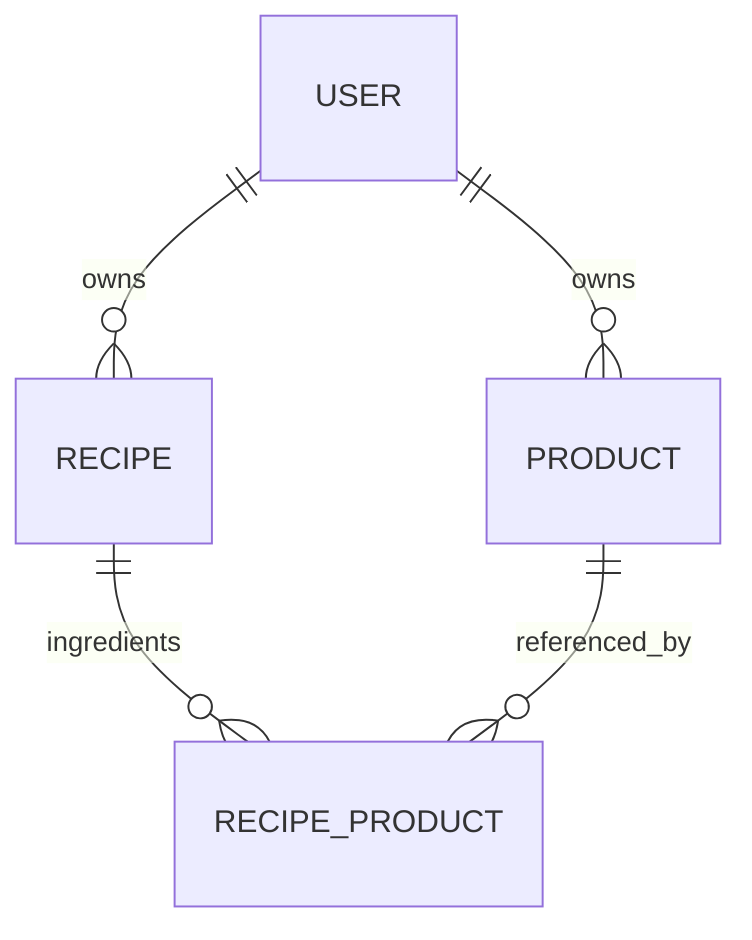

# Recipe data model

TASK-18 adds user-owned recipes and a custom ingredient pivot linked to existing
Products. Recipe endpoints, frontend screens and nutritional calculation services
are not implemented. Both new migrations remain pending in development; schema
and record-writing verification ran in the guarded isolated testing environment.

## Schema and relationships

| Table            | Column                     | Type and rules                                                                 |
| ---------------- | -------------------------- | ------------------------------------------------------------------------------ |
| `recipes`        | `id`                       | Bigint primary key.                                                            |
|                  | `user_id`                  | Required User foreign key; owner deletion restricted.                          |
|                  | `name`                     | Required nonblank varchar(255).                                                |
|                  | `description`              | Optional text.                                                                 |
|                  | `servings`                 | Required positive integer, 1–2,147,483,647; no implicit default.               |
|                  | `created_at`, `updated_at` | Eloquent timestamps.                                                           |
| `recipe_product` | `id`                       | Bigint primary key for native custom-pivot persistence and factories.          |
|                  | `recipe_id`, `product_id`  | Required bigint references; each recipe/product pair is unique.                |
|                  | `user_id`                  | Required owner derived from the recipe; shared by both composite foreign keys. |
|                  | `quantity_g`               | Required exact numeric(10,3), greater than zero, at most 9,999,999.999 grams.  |
|                  | `created_at`, `updated_at` | Eloquent pivot timestamps.                                                     |

Serving and weight maxima express storage capacity, not recommended recipe sizes.
Servings count whole portions; fractional serving counts are rejected by model
validation. Milligram precision is supported for ingredient weights. Eloquent's
`decimal:3` cast returns fixed-scale strings; callers should supply decimal strings.
No calculated calories, macros, total weight or per-serving totals are persisted.

`User::recipes()` and `Recipe::user()` define ownership. `Recipe::ingredients()`
returns `RecipeIngredient` records; each belongs to its recipe and product.
`Recipe::products()` and `Product::recipes()` use that custom Pivot class, with
`id`, `user_id`, `quantity_g` and timestamps available on `pivot`.
`Product::recipeIngredients()` exposes its ingredient records.
The `recipe_product` table is named explicitly in both many-to-many relationships.

A product can appear in multiple recipes, but only once within one recipe; combine
repeated uses into one gram quantity. Empty recipes are structurally allowed at
this foundation stage. TASK-19 must decide and validate its HTTP ingredient-count
contract. Quantity and servings validation already applies to model saves, and
standard custom-pivot attach/update paths use those saves.

Indexes include `(user_id, name)` for owned recipes, unique `(recipe_id, product_id)`
for duplication/recipe lookup, and `(product_id, user_id)` for reverse references.
Unique `(id, user_id)` targets on recipes and products support the composite foreign
keys. The existing Product migration is unchanged; the new pivot migration adds that
Product index without rewriting rows.

## Ownership enforcement

Recipe ownership is excluded from mass assignment: create through the authenticated
user's `recipes()` relationship with validated business fields. Ingredient mass
assignment accepts only `product_id` and `quantity_g`. Create through the recipe's
ingredient relationship; recipe and owner IDs are not client-editable fields.
The ingredient saving hook validates IDs/quantity, derives the recipe owner, and
requires the product to exist within that owner before writing. Missing and foreign
references produce validation errors without disclosing product details. Model
validation also rejects null-byte text before PostgreSQL receives it.

Database enforcement uses:

- `(recipe_id, user_id)` → `recipes(id, user_id)` with `ON DELETE CASCADE`.
- `(product_id, user_id)` → `products(id, user_id)` with `ON DELETE RESTRICT`.

The same non-null owner must match both parents. This blocks cross-user links even
through raw SQL/model-event bypasses and prevents ownership changes on referenced
parents. The extra owner column is deliberate integrity data, not a nutritional
cache. PostgreSQL requires unique parent-key targets for composite references;
see [PostgreSQL constraints](https://www.postgresql.org/docs/18/ddl-constraints.html).

PostgreSQL CHECK constraints reject blank names, nonpositive servings and nonpositive/
non-finite weights. Model validation rejects excess fractional quantity digits
instead of letting PostgreSQL round them. Bulk Query Builder writes bypass model
validation but still face database constraints. SQLite is optional model smoke
coverage; PostgreSQL is authoritative for numeric/CHECK behavior.

Laravel discovers the real `RecipePolicy`: guests are denied, visible actions are
owner-only, and foreign private actions deny as 404. This does not filter queries or
authenticate model saves. **TASK-19 still must implement and test HTTP authentication,
scoped queries, Form Requests, explicit Policy calls and ownership validation for
every submitted ingredient.** Multi-ingredient create, attach/sync and update must
run in a transaction: native batch relationship operations are not automatically
all-or-nothing. See [authorization.md](authorization.md).

## Deletion and nutrition implications

Deleting a recipe cascades only its ingredient rows; products and other recipes
remain. Deleting an owning User with recipes is restricted, matching existing Product
behavior. Account removal needs a deliberate later workflow.

A referenced product cannot be deleted, including through direct SQL. The existing
Product DELETE API translates the known foreign-key restriction into HTTP 409 with a
safe explanation; unrelated database exceptions remain errors. The transaction rolls
back before translation. This relies on the constraint rather than a race-prone
pre-check, and normal unreferenced deletion remains 204. The existing Product dialog
explains the conflict without hiding/removing the product. Detach or replace recipe
uses before deleting their product.

Products remain mutable nutrition references. No snapshots, historical nutrition
rules or calculation service are introduced. Future calculations can use quantities,
current per-100-g nutrition and servings; those calculations and later food-log
history requirements belong to subsequent tasks.

## Factories, tests and migration safety

`Recipe::factory()->for($user)->create()` reuses an owner; otherwise it creates one.
`RecipeIngredient::factory()->create()` creates a recipe and a product for the same
owner. Use `->for($recipe)->for($product)` to reuse matching parents. No Faker dependency
was added. See Laravel's [custom pivot conventions](https://laravel.com/framework/docs/eloquent-relationships).

Feature tests cover factories, bidirectional relationships, pivot persistence,
decimal strings, validation, ownership, Policy discovery, cross-user writes and
deletion/API behavior. PostgreSQL tests bypass models to verify constraints, parent
ownership immutability, exact numeric storage, index targets and cascade/restriction
behavior. Writes use generated restricted databases with transactions/savepoints.

The development database and existing records were preserved. Apply both migrations
only through the reviewed [migration workflow](database.md), after confirming the
target. No resets or automatic startup migrations were added. See [testing.md](testing.md)
and [VERIFICATION.md](VERIFICATION.md) for commands/results.
